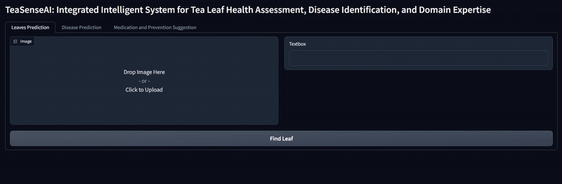
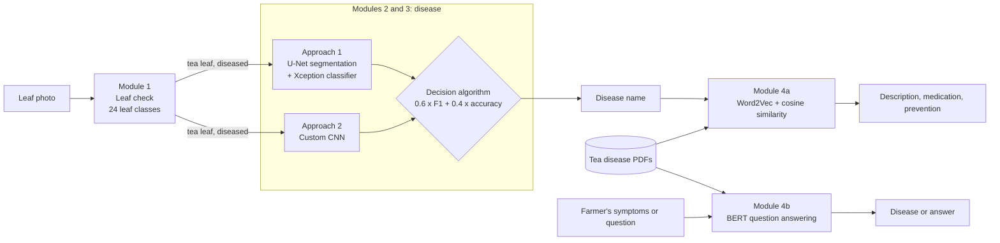

# Tea Leaf Disease Diagnosis and Treatment Recommendation

A research prototype that checks a leaf photo, names the tea leaf disease, and answers treatment questions from a set of tea documents.



The app in use (20 s cut). The full recording is [Demonstration.mkv](Demonstration.mkv).

## Why it exists

A disease on one tea plant can spread to the plants around it.
Today, finding and naming the disease depends on the experience of the farmer, and a wrong call is costly.
Spraying pesticide without a clear diagnosis wastes money and harms the environment.
This project tries to make the diagnosis and the first treatment advice automatic, from a single photo.

## How it works



The original architecture figure from the project presentation:


**Module 1, leaf check.**
A CNN sorts a leaf photo into 24 classes across 13 plant species, healthy or diseased, with tea among them.
In the app it is the first tab: it tells whether the photo is a tea leaf and whether it looks diseased.
Training images are augmented so that every class has up to 200 samples.
Notebook: `Module 1/tea_leaf_classifiaction.ipynb`.

**Module 2, preprocessing and segmentation.**
Labelled leaf and spot polygons are turned into masks (`Module 2 & 3/preprocessing.ipynb`).
A U-Net learns to mark background, leaf and diseased spots at 256 x 256 (`Module 2 & 3/segmentation_pipeline.ipynb`).
The presentation also covers a denoising autoencoder and OpenCV denoising for blurred images.

**Module 3, two disease classifiers and a decision.**
The project covers five tea diseases: algal leaf, brown blight, grey blight, red leaf spot and white spot.
Approach 1 is an Xception classifier trained next to the U-Net.
Approach 2 is a custom CNN (`Module 2 & 3/tea_leaf_disease_classification.ipynb`).
A decision algorithm scores each approach from its saved classification report and returns the prediction of the higher one.

**Module 4, treatment and tea knowledge.**
Text is pulled from tea disease PDFs with pdfplumber.
For description, medication and prevention, each sentence is embedded with Word2Vec and the closest sentence to the request wins by cosine similarity.
For free-text symptoms and general tea questions, a BERT question answering model reads the documents and returns the answer span.
DistilBERT and RoBERTa were also fine-tuned on SQuAD v2 with Haystack to compare readers (`Module 4/models/`).

**Interface.**
`Integrating_all_modules.ipynb` joins the modules in a Gradio app (TeaSenseAI) with three tabs: leaf prediction, disease prediction, and medication and prevention.
Two more Gradio apps serve the symptom checker and the tea knowledge questions.

## Stack and key decisions

Python, TensorFlow and Keras, OpenCV, scikit-learn, Hugging Face Transformers, Haystack, gensim (Word2Vec), NLTK, pdfplumber, Gradio, Jupyter and Google Colab.

- **Two disease classifiers joined by a decision rule that weighs F1 above accuracy.**
  Accuracy alone gives an unfair picture on unbalanced data, so the rule scores each model as 0.6 x weighted F1 + 0.4 x accuracy and keeps the better one (presentation, Module 3 research gap and decision algorithm slides).
- **Balanced classes for the leaf check.**
  Some classes had far more images than others, so each class is augmented up to 200 images before training (presentation, Module 1 research gap; `balance` function in the Module 1 notebook).
- **Word2Vec embeddings for the treatment lookup.**
  The first version, a plain split with cosine similarity, gave inaccurate answers, so the Word2Vec hidden weights were used as word embeddings instead (presentation, Module 4 slides).

## Results

These numbers come from different splits and runs, so read them per module, not as one benchmark.

| Module | Model | Measure | Value | Source |
| --- | --- | --- | --- | --- |
| 1 Leaf check | Custom CNN, 22 classes | Test accuracy, 676 images | 72.19% | Module 1 notebook output |
| 1 Leaf check | ResNet50 (baseline for comparison) | Train / test accuracy | 95.5% / 82.5% | Presentation, Module 1 evaluation |
| 2 Segmentation | U-Net | Precision / recall / F1 / accuracy | 0.9492 / 0.9295 / 0.9392 / 0.9330 | Presentation, Module 2 evaluation |
| 3 Disease | Custom CNN | Validation accuracy / weighted F1, 128 images | 0.53 / 0.53 | `Module 2 & 3/weights/custom_cnn_report` |
| 4 Question answering | RoBERTa base, SQuAD v2 dev | Exact match / F1 | 81.9 / 84.2 | `Module 4/models/custom_train_roberta_sqad_v2.ipynb` |
| 4 Question answering | DistilBERT, SQuAD v2 dev | Exact match / F1 | 43.3 / 45.5 | `Module 4/models/custom_train_bert_sqad_v2.ipynb` |

## How to run it

The notebooks were written for Google Colab with files on Google Drive.
Every path in them starts with `/content/gdrive/MyDrive/...`, so point those paths at your own copies before you run a cell.

1. Clone the repository. The model weights are tracked in git, and some files are over 80 MB.

   ```bash
   git clone https://github.com/pasindu-premachandra/Intelligent-Diagnosis-and-Treatment-Recommendation-System-for-Tea-Leaf-Diseases.git
   ```

2. Install the libraries the notebooks import. There is no requirements file, so this list comes from the import cells.

   ```bash
   pip install tensorflow opencv-python numpy pandas scikit-learn matplotlib seaborn tqdm gradio pdfplumber nltk gensim transformers torch
   pip install farm-haystack   # only for the reader fine-tuning notebooks in Module 4/models
   ```

3. Open `Integrating_all_modules.ipynb` in Colab or Jupyter and run it top to bottom. Gradio prints a local URL for the app.

What is in the repository:

- `Module 1/weights/` - a leaf classifier (`model_01.json`, `model_01_weights.h5`).
- `Module 2 & 3/weights/` - the U-Net (`segmentation.h5`), the Xception classifier (`classification.h5`), the custom CNN (`tea-disease-classifier.hdf5`) and its report (`custom_cnn_report`).
- `Module 4/models/model.txt` - links to the Word2Vec and BERT model files.

What is not in the repository, so you need your own copy: the `model_02` leaf classifier that the integration notebook loads, the `xception_report` file, the tea disease PDFs, and the image datasets.

## Team and credits

Final-year research project by Group 41, Team Sparta:

- Premachandra P.K.P.G.
- Herath H.M.S.C.B.
- Senanayake T.A.D.S.L.
- Vindula S.G.T.

Supervisor: Ms. Rajapaksha H.P.S.C.

Pretrained models used: Xception (Keras Applications), BERT for question answering (Hugging Face Transformers), `deepset/roberta-base-squad2` and `distilbert-base-uncased-distilled-squad` (Hugging Face, through Haystack), and the Google News Word2Vec vectors (gensim).

## License

No license yet: the team is agreeing on one. Until then, all rights stay with the project authors.
Pretrained models and datasets keep their own licenses.
